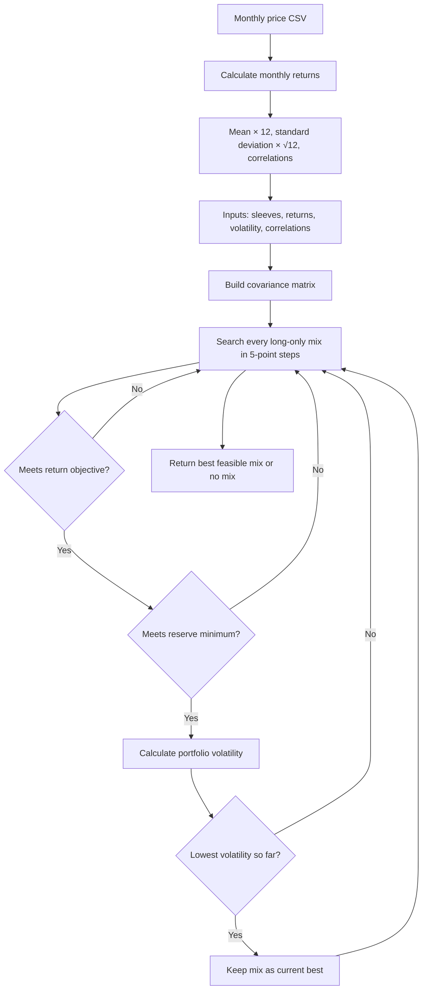

# Lab 15 — Meridian Fund Universe and Portfolio Design

**Date:** October 22, 2026

## Fund universe

The investable universe contains four diversified sleeves:

| Sleeve | Role in the universe |
|---|---|
| Treasury bills | Cash-like reserve sleeve |
| Treasury 10-year note | Government fixed-income sleeve |
| Investment-grade bond fund | Diversified bond sleeve |
| Global equity index fund | Diversified equity sleeve |

## Objective and hard constraint

**Objective:** achieve an expected return of at least **6.5%** (CPI estimated at 2.5% plus 4.0%).

**One hard constraint:** allocate at least **3.0%** of the reserve to eligible liquidity—Treasury bills and/or the Treasury 10-year note—to cover four quarterly $0.75 million distributions from the $100 million reserve.

## Monthly adjusted-close price data

[prices.csv](prices.csv) contains **60 completed monthly adjusted-close observations** from October 2021 through September 2026. Each row is a calendar month; prices are in U.S. dollars and retain six decimal places from the source download.

| Sleeve | Ticker used | Price source | Download date |
|---|---|---|---|
| Cash-like reserve sleeve | BIL | [Yahoo Finance historical data](https://finance.yahoo.com/quote/BIL/history/) | October 22, 2026 |
| Government fixed-income sleeve | IEF | [Yahoo Finance historical data](https://finance.yahoo.com/quote/IEF/history/) | October 22, 2026 |
| Diversified bond sleeve | LQD | [Yahoo Finance historical data](https://finance.yahoo.com/quote/LQD/history/) | October 22, 2026 |
| Diversified equity sleeve | ACWI | [Yahoo Finance historical data](https://finance.yahoo.com/quote/ACWI/history/) | October 22, 2026 |

The file uses Yahoo Finance's monthly **adjusted close** field. IEF is a 7–10-year Treasury ETF used as a practical liquid proxy for the course's Treasury 10-year-note sleeve; it is not an individual Treasury security. The other ticker choices are likewise ETF implementations of the four sleeve roles, so their historical returns and risk need not equal the course-authored training estimates in Lab 14.

## Client page and minimum-risk result

`app.py` is the Streamlit client page for this lab. It searches every long-only mix in 5-percentage-point steps using the Lab 14 course assumptions, retaining the lowest-volatility mix that meets a 100% total allocation, the selected expected-return objective, and the selected eligible-liquidity requirement. It also accepts an uploaded three-to-six-ticker price CSV and calculates annualized historical estimates from it.

With the Meridian inputs, the least-risk mix that meets the stated numeric mandate is:

| Sleeve | Weight |
|---|---:|
| Treasury bills | 0.00% |
| Treasury 10-year note | 20.00% |
| Investment-grade bond fund | 25.00% |
| Global equity index fund | 55.00% |

The mix has a 6.51% expected return, 9.44% volatility, and 20.00% eligible liquidity. The liquidity result is above 3% because the app tests 5-point weight increments.

For the one-point check, increasing the global-equity expected-return estimate from 8.0% to 9.0% changes the mix to 5.00% Treasury bills, 0.00% Treasury notes, 55.00% investment-grade bonds, and 40.00% global equity. Its volatility is 7.90%. The answer therefore does **not** survive this one-point change unchanged; the recommendation is estimate-sensitive.

Run the page from this folder with `streamlit run app.py` in the Python environment where Streamlit is installed.

## Portfolio engine flow

## Project 2 ETF universe — historical-estimate result

The `prices.csv` observations span October 2021 through September 2026 (60 month-end prices and 59 monthly returns). Expected returns below are **annualized arithmetic averages of historical monthly returns**, not forecasts.

| Fund | Historical annualized return estimate | Annualized volatility |
|---|---:|---:|
| BIL | 3.66% | 0.49% |
| IEF | −1.73% | 7.72% |
| LQD | −0.93% | 9.87% |
| ACWI | 11.25% | 14.88% |

Using the same numeric objective as the Meridian exercise (at least 6.5%) and the same stated liquidity constraint (at least 3.0% in BIL and/or IEF), the app's 5-point search gives these results:

| Price window | Lowest-risk mix | Historical return estimate | Estimated volatility | Eligible liquidity |
|---|---|---:|---:|---:|
| All 59 monthly returns, Nov. 2021–Sept. 2026 | 60% BIL, 40% ACWI | 6.69% | 6.03% | 60.00% |
| Last 36 monthly returns, Oct. 2023–Sept. 2026 | 85% BIL, 15% ACWI | 6.79% | 1.77% | 85.00% |

IEF and LQD receive 0% in both runs. The largest allocation change is BIL, which increases by 25 percentage points when the window changes to the last 36 months. This is an estimate-sensitivity result, not a claim about future returns.

## Fresh-eyes estimate challenge

The most consequential estimate is ACWI's historical return estimate because ACWI supplies the return needed to reach the 6.5% objective. Reducing that estimate by one percentage point changes the all-months mix from 60% BIL / 40% ACWI to 55% BIL / 45% ACWI and raises estimated volatility from 6.03% to 6.77%; the allocation should therefore be treated as sensitive to the equity-return assumption.

**Partner attack:** Allie asked, “What happens if ACWI is a whole percentage point lower?” I responded: “The mix changes from 60% BIL and 40% ACWI to 55% BIL and 45% ACWI, while estimated volatility rises from 6.03% to 6.77%.”

## Decision

**Pilot, with a condition.** Use the 60% BIL / 40% ACWI mix only as a small, monitored pilot while documenting the return-estimation method and reassessing it before implementation or rebalancing. The 25-point shift between the all-months and last-36-month windows, plus the ACWI estimate challenge, means the result is useful for learning and scenario comparison but not robust enough to call an “optimal” permanent allocation.

If an input combination has no feasible 5-point mix, the app reports “No mix meets the objective and reserve requirement at 5-point steps”; it does not lower the stated objective to manufacture a result.

## Known-answer proof

The Meridian grid search reproduced the required checks:

| Run | Bills / 10-year / IG / equity | Return | Volatility |
|---|---|---:|---:|
| As loaded | 0 / 20 / 25 / 55 | 6.51% | 9.44% |
| Global-equity return estimate changed from 8.0% to 7.0% | 0 / 10 / 10 / 80 | 6.53% | 12.94% |
| IG–equity correlation temporarily changed from 0.25 to 0.50 | 0 / 40 / 0 / 60 | 6.52% | 9.73% |

The largest change in the one-point return test is 25 percentage points. The correlation was returned to 0.25 in both cells after the proof.
